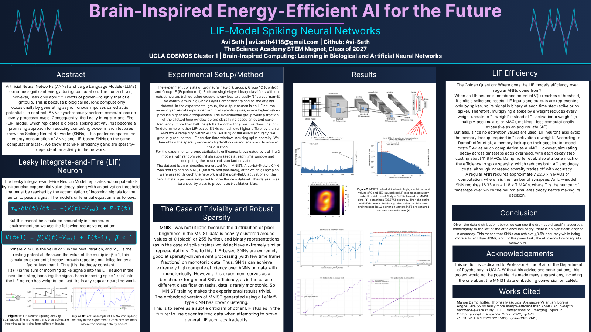

# Brain-Inspired Energy-Efficient AI for the Future
### LIF-Model Spiking Neural Networks

**Avi Seth**, The Science Academy STEM Magnet (Class of 2027)
UCLA COSMOS 2026, Cluster 1: *Brain-Inspired Computing: Learning in Biological and Artificial Neural Networks*

## Contributions and AI use

This project was done during the UCLA COSMOS 2026 program (Cluster 1), where AI coding assistants were permitted.

- **Work:** SNN Energy efficiency hypothesis, the experiment design (control ANN vs. a single LIF neuron, decision-window, and energy comparison), transition from raw MNIST to embedded features due to triviality, analysis and conclusion.
- **Mentor:** Prof. H. Tad Blair (UCLA Psychology) contributed core ideas to the experimental design, including the LeNet-5 embedding of MNIST.
- **AI assistance:** Claude Opus (Anthropic) wrote most of the code to my specifications (including data loading and spike encoding, the ANN and LIF models, training and evaluation, the energy calculations, the plots, and the interactive LIF demo).



## Overview

Spiking neural networks (SNNs) are widely described as more energy-efficient than conventional artificial neural networks (ANNs). This project tests that claim on a small, tightly controlled task. A single-layer ANN and a single leaky integrate-and-fire (LIF) neuron are trained on the same binary problem (specifically for 3 in this case), and the accuracy and modeled energy per inference are compared as the LIF neuron's decision window is shortened.

**Research question:** Can an LIF-based classifier use less energy than an equivalent ANN while staying within 0.5% of its accuracy, and what is the reason for the efficiency advantage?

## Method

Both groups have the same input width and one output, use the same class-balanced train/test splits (10,000 / 2,000), and are trained with binary cross-entropy for the same number of epochs.

| Group | Input | Model | Decision |
|---|---|---|---|
| Control (1C) | Static, real-valued features | `Linear(n, 1)` (logistic regression) | logit > 0 |
| Experimental (1E) | Same features, rate-encoded as spike trains over `T` timesteps | `Linear(n, 1)` applied at each timestep, driving one LIF neuron (snnTorch `Leaky`, beta = 0.9) | output spikes > half the processed timesteps |

**Rate encoding.** At every timestep each input spikes independently with probability proportional to its value (Bernoulli sampling/Poisson rate encoding used by snnTorch's `spikegen.rate`). Spike trains are drawn once with a fixed seed and frozen as a dataset.

**Window coverage.** `T_WINDOW_FRACTION` sets how many of the `T` timesteps the LIF neuron processes before deciding. Shorter window means fewer input spikes and fewer operations. Each window is trained with several random seeds and reported as mean ± SD.

| Experiment | Notebook | Inputs (n) | Encoding |
|---|---|---|---|
| 1: Raw MNIST | `ann_vs_lif_normalsized.ipynb` | 784 pixels | spike probability = pixel brightness (0 to 1), `T = 10` |
| 2: EmbedMNIST | `ann_vs_lif_embedding_sized.ipynb` | 84 features | spike probability = activation / 28, `T = 30` |

**Why EmbedMNIST.** MNIST pixel values are bimodal on the logarithmic scale(clustering almost entirely at 0 and 255), so the comparison is trivially favourable to the SNN. EmbedMNIST replaces each image with the 84 post-ReLU activations of the penultimate layer of a LeNet-5 CNN trained on MNIST (98.87% test accuracy). These values are far less clustered (about half are exactly zero, the rest spread up to about 28), so Experiment 2 is the more meaningful test. The Spiking Heidelberg Digits (SHD) dataset was initially considered but does not allow a width-matched comparison with the 784-input baseline.

## Energy model

Operation counts are measured from the forward pass. Energy is **modelled**, in normalized units, and ratios are applied. The model is derived from the approach of Dampfhoffer et al. [1]: on digital accelerators, memory access rather than arithmetic dominates energy (see also Horowitz [2]). Per inference:

```
E_ANN = 22.6  x N_MAC
E_SNN = 16.33 x N_AC  +  11.8 x N_neurons x T_eff
```

- **MAC** (multiply-accumulate): one per synapse per ANN inference (`activation x weight`).
- **AC** (accumulate): one per input spike per synapse. Because a spike is 0 or 1, `activation x weight` becomes `+ weight`, and no activation value has to be fetched from memory.
- **Leak**: one LIF membrane update per neuron per processed timestep, paid whether or not a spike occurs.

The constants are the memory-inclusive per-operation costs used in the notebooks, derived from [1]. The SNN's advantage therefore depends on **sparsity**. It has realized advantages only when few input spikes arrive to offset the per-timestep leak cost.

## Results (Experiment 2, EmbedMNIST)

ANN control accuracy: **99.12%**.

| LIF window | LIF accuracy | Gap to ANN | Modelled energy vs ANN |
|---|---|---|---|
| 30/30 (full) | 98.39 ± 0.13% | 0.73 pp | 2.19x |
| 13/30 | 98.59 ± 0.17% | 0.53 pp | 0.95x |
| 7/30 | 98.28 ± 0.12% | 0.84 pp | 0.51x |
| 6/30 | 97.66 ± 0.12% | 1.46 pp | 0.44x |
| 1/30 | 91.07 ± 0.23% | 8.05 pp | 0.07x |

*Values from the window curve recorded in section 9 of `ann_vs_lif_embedding_sized.ipynb`.*

- Modelled energy falls linearly as the window shrinks. The LIF arm becomes cheaper than the ANN only at or below about 13/30 (about 43%) of its window.
- From 13/30 down to 7/30, accuracy stays roughly flat (98.3% to 98.6%), trailing the ANN by about 0.5 to 0.9 while using up to about half the modelled energy. Below 7/30, accuracy falls off sharply. Curve imitates expected logarithmic curve.
- The closest the 2E group came to the 0.5% target of 2C while also being cheaper was 0.53% (at 13/30), within the error bar.
- **Conclusion:** Efficiency gain is tight. A large part is derived from spike sparsity with tradeoff against accuracy (consistent with [1]). The difference in results between Class 1 and Class 2 groups should serve as a criticism against the usage of industry standards like MNIST when comparing efficiencies of neural networks.

## Repository contents

| File | Description |
|---|---|
| `COSMOS_SNN_Project.png` | Project poster |
| `ann_vs_lif_normalsized.ipynb` | Experiment 1: 784-input ANN vs LIF on raw MNIST |
| `ann_vs_lif_embedding_sized.ipynb` | Experiment 2: 84-input ANN vs LIF on EmbedMNIST, with energy model and window sweep |
| `EmbedMNIST.npz` | LeNet-5 features: `train_X` (60000 x 84), `train_y`, `test_X` (10000 x 84), `test_y` |
| `LeakLIF.ipynb` | Interactive single LIF neuron demo (ipywidgets) |
| `Project_Diagrams.zip` | Poster figures (raster plots, LIF activity, data distributions, result plots) and a live LIF demo notebook |


Both experiment notebooks also include per-sample spike raster plots and LIF membrane/spike plots that are not shown on the poster. The LeNet-5 training code used to produce `EmbedMNIST.npz` is not included; the extracted features are.

## Running the notebooks

The notebooks are written for Google Colab (a GPU is optional).

- **Dependencies:** PyTorch, torchvision, snnTorch, NumPy, Matplotlib, tqdm. The first cell installs snnTorch if it is missing.
- **Experiment 1** downloads MNIST automatically through torchvision.
- **Experiment 2** reads `EmbedMNIST.npz` from this repo. Upload it to Colab or Google Drive and set `EMBEDMNIST_PATH` in cell 1B (set `MOUNT_DRIVE = False` if the file is on the local Colab disk).
- **Settings** live in the `CFG` cell: `T`, `T_WINDOW_FRACTION`, `BETA`, `SEEDS`, `N_TRAIN`, `N_TEST`.


## Limitations

- One layer, one output neuron, one binary task. Results may not transfer to deeper networks or other tasks.
- Energy is modelled for one class of digital accelerator, not measured on neuromorphic hardware.
- The spike trains are a lossy re-encoding of the control's inputs, so the LIF arm can at best tie the ANN on accuracy. The encoding and the output neuron change together, so any accuracy gap reflects both.

## Acknowledgements

Thanks to **Prof. H. Tad Blair** (UCLA Department of Psychology) for core ideas behind the experimental design, including the LeNet-5 embedding of MNIST.

## References

1. M. Dampfhoffer, T. Mesquida, A. Valentian, and L. Anghel, "Are SNNs Really More Energy-Efficient Than ANNs? An In-Depth Hardware-Aware Study," *IEEE Transactions on Emerging Topics in Computational Intelligence*, vol. 7, no. 3, pp. 731-741, 2023 (published online Nov. 2022). doi: [10.1109/TETCI.2022.3214509](https://doi.org/10.1109/TETCI.2022.3214509)
2. M. Horowitz, "Computing's energy problem (and what we can do about it)," in *2014 IEEE International Solid-State Circuits Conference Digest of Technical Papers (ISSCC)*, pp. 10-14, 2014. doi: [10.1109/ISSCC.2014.6757323](https://doi.org/10.1109/ISSCC.2014.6757323)

## License

MIT. See [LICENSE](LICENSE).
